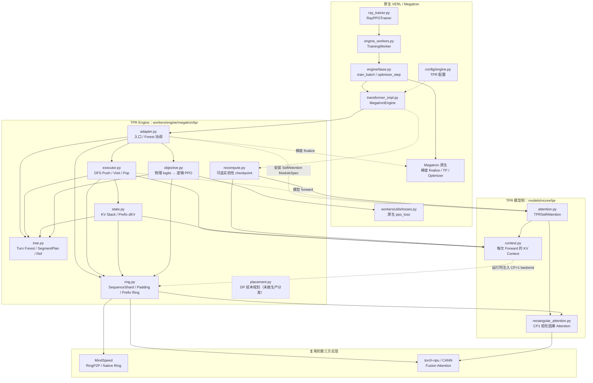

# TPR开发文档

> **项目**：VERL-TPR（**Tree Prefix Reuse，树形前缀复用**）  
> **代码基线**：`verl-tpr/main` — [`93b24dff`](https://github.com/1903943257/verl-tpr/commit/93b24dff45d959a56b609cd99893ea90c1b94212)，2026-10-19（已合入 Ring/数值归因 PR #10）  
> **用途**：项目交付、代码评审、组件维护；本文对照当前主线代码说明功能、修改范围、运行逻辑、验证入口和限制。

## 1. 项目功能与实现范围

TPR 针对 Agent RL actor 更新中多条轨迹具有相同对话前缀、而 Full Sequence 训练对这些前缀重复前反向计算的问题。它将原始 PPO mini-batch 中可共享的 **完整 Turn 前缀**构成一棵或多棵树，按 Segment 执行，并复用内部节点的逐层 KV。

**训练侧 Prefix KV 不能只缓存前向值**：后代分支的 Loss 会对公共前缀产生 dK/dV。TPR 在执行叶子时收集这些梯度，并在回退到内部节点时重算该 Segment，接力反传后代 dKV，最终得到共享前缀的参数梯度。

项目采用“**最小化改动 VERL/Megatron**”的实现方式：

- **TPR 新增**：Turn 构树、树内 DFS 调度、Segment KV 生命周期与 dKV 接力、外部 KV SelfAttention、逻辑 PPO 目标映射、Prefix-aware Ring CP。
- **直接复用**：VERL rollout/reward/actor update、原生 PPO clipping 与 loss callback、Megatron QKV/输出投影/TP、原生 optimizer/scheduler、Megatron 进程组及梯度 finalize、MindSpeed RingP2P、Ascend CANN Attention。
- **不做的事**：不独立实现 PPO 算法、不替换整个 RL Trainer、不重新实现 TP 通信，也不在不同 DP replica 间复用 Prefix KV。

生产 Dense Actor PPO 的并行与模型范围以 §9 和运行时门禁为准。源码存在或单项离线 PASS，不自动表示生产端到端训练已经支持。

## 2. 与原生 VERL 的接口边界

### 2.1 真正需要修改的框架文件

| 文件 | 改动内容 | 必要性 |
| --- | --- | --- |
| [`verl/workers/config/engine.py`](../../verl/workers/config/engine.py) | `McoreEngineConfig.tpr_enabled`、`tpr_cp_backend` 等选项 | 功能开关 |
| [`verl/workers/engine/megatron/transformer_impl.py`](../../verl/workers/engine/megatron/transformer_impl.py) | **模型构建时**安装 TPR SelfAttention 的 ModuleSpec；**训练前反向时**转入 `run_tpr_forward_backward_batch()` | 两个真正的框架接入点 |

`adapter.py` 将 `SelfAttention` 的 **ModuleSpec** 替换为 `TPRSelfAttention`，保留原生模块参数和 TP 结构；覆盖的是模型实例的构建路径（包括 vanilla MBridge），**不修改 Megatron-LM / MindSpeed 源文件**。没有 TPR Context 的 `TPRSelfAttention.forward()` 仍委托原生 Megatron forward。

### 2.2 原生调用者：不属于 TPR 接入点

| 文件 | 实际作用 |
| --- | --- |
| [`verl/trainer/ppo/ray_trainer.py`](../../verl/trainer/ppo/ray_trainer.py) | `fit()` → `_update_actor()` → 原生 `actor_rollout_wg.update_actor()`；**没有直接调用 TPR** |
| [`verl/workers/engine_workers.py`](../../verl/workers/engine_workers.py) | `update_actor()` / `train_mini_batch()` / `train_batch()`；把**原生 PPO loss_fn** 传入 Engine |
| [`verl/workers/engine/base.py`](../../verl/workers/engine/base.py) | 原生 `train_batch()` 执行 `optimizer_zero_grad()` → `forward_backward_batch()` → `optimizer_step()` |
| [`verl/workers/utils/losses.py`](../../verl/workers/utils/losses.py) | 真正执行原生 `ppo_loss()`；TPR 不另写 PPO clipping/advantage 算法 |

`engine_workers.py` 当前还有可选 `TPR_CAPTURE_ACTOR_MINIBATCH_DIR` 插桩，仅在 `self.train_batch(mini_batch_td)` 之前将真实 actor-update mini-batch 克隆、写盘，便于离线 Full/TPR 回放。**它是实验数据采集代码，不属于 TPR 训练功能依赖，可在生产代码精简时移除**；不要把它与 `torch.profiler.record_function()`、原生 profiler step 混为一谈。

### 2.3 端到端训练调用链

```text
RayPPOTrainer.fit()
  └─ _update_actor(batch)
      └─ actor_rollout_wg.update_actor(batch_td)
          └─ TrainingWorker.train_mini_batch()
              └─ TrainingWorker.train_batch()
                  └─ engine.train_batch(data, loss_function=self.loss_fn)  [原生]
                      ├─ optimizer_zero_grad()                              [原生]
                      ├─ MegatronEngine.forward_backward_batch()
                      │   ├─ 原生计算 GLOBAL batch_num_tokens / dp_size
                      │   ├─ tpr_enabled=False → 原生 prepare_micro_batches + Full F/B
                      │   └─ tpr_enabled=True  → adapter.run_tpr_forward_backward_batch()
                      │       ├─ Turn Forest 构建、TP×CP plan 校验
                      │       ├─ SegmentPPOObjectiveAdapter
                      │       ├─ run_forest() → 每棵树 SegmentExecutor.run()
                      │       │   └─ Push / Visit / Pop → TPRSelfAttention
                      │       │       └─ CP1 rectangular 或 CP>1 Ring
                      │       │           → 原生 PPO loss_fn → backward + Prefix dKV
                      │       └─ Megatron finalize_model_grads_func() 一次
                      └─ optimizer_step()                                  [原生]
```

**时序要求**：TPR 在原生 `batch_num_tokens` 和 `dp_size` 计算完成后、原生 `prepare_micro_batches()` 之前分流；不能先把可能共享 Prefix 的兄弟轨迹拆成彼此不可见的 micro-batch。TPR 自己完成 Segment backward，但不替代 Engine optimizer step。

## 3. TPR 新增组件与源码职责

### 3.1 各模块之间的依赖图

下面的图以**生产训练路径中的模块调用和代码依赖**为主，按仓库中的实际文件组织；箭头从**调用方/依赖方**指向**被调用方/依赖组件**。**实线**表示主线调用或代码依赖，**虚线**表示配置、模型构建注入或可选路径。该图是模块依赖关系，§2.3 则是一次完整训练步骤的执行顺序，两者不等价。



**关键边界和阅读方式：**

- **框架接入**：`transformer_impl.py` 仅在模型构建与训练前反向两个位置接入 TPR；`adapter.py` 统一构树、创建单树 Executor、收集指标与触发原生梯度 finalize。原生 `BaseEngine.train_batch()` 仍负责 optimizer zero-grad/step。
- **树调度**：`tree.py` 生成 Forest/Tree/Segment 和 ObjectiveRef；**`executor.py` 只负责 Tree 内 DFS**；`adapter.run_forest()` 负责 Tree 间顺序执行和整个 mini-batch 的梯度收尾。
- **Prefix KV**：`executor.py` 操作 `state.py` 的长期 KV/dKV；`context.py` 仅管理一次模型 forward；`attention.py` 从 Context 读取外部 Prefix KV。CP1 经 `rectangular_attention.py`，CP>1 由 Context 注入 Ring backend。
- **PPO 适配**：`objective.py` 依赖 `tree.py` 的逻辑 Ref 和 `ring.py` 的 CP 位置映射，但**最终调用的是原生 `ppo_loss()`**，不依赖实验数据采集脚本。
- **并行与非生产路径**：`ring.py` 中同时维护 SequenceShard、Padding、逻辑/物理索引及 Ring；它复用 MindSpeed 传输而不是自建 CP 通信框架。`recompute.py` 是显式开启的实验性路径；`placement.py` 当前与生产 Trainer dispatch **没有调用边**。TP 一致性验证位于 `tree.py`，没有单独的 TPR TP 算法模块。

### 3.2 Engine 侧：`verl/workers/engine/megatron/tpr/`

| 文件 | 主要职责 | 关键接口 |
| --- | --- | --- |
| [`adapter.py`](../../verl/workers/engine/megatron/tpr/adapter.py) | 安装模型 ModuleSpec、并行/模型门禁、构树与批次执行入口、统一 finalize/metrics | `install_tpr_module_spec()`、`run_tpr_forward_backward_batch()`、`run_forest()` |
| [`tree.py`](../../verl/workers/engine/megatron/tpr/tree.py) | Qwen Turn 共享前缀树、Segment 关系、逻辑 PPO query owner、TP×CP plan 签名 | `build_tree_execution_plans()`、`digest_forest_plan()`、`assert_tp_plan_agreement()` |
| [`executor.py`](../../verl/workers/engine/megatron/tpr/executor.py) | 单棵树确定性 DFS、Push/Visit/Pop、forward/backward、RoPE Segment 位置、replay 校验 | `SegmentExecutor.run()`、`push()`、`visit_leaf()`、`pop()` |
| [`state.py`](../../verl/workers/engine/megatron/tpr/state.py) | DFS 路径 KV 栈、graph-free Push 缓存、祖先 gradient anchor、dKV 累计和释放 | `KVStack`、`KVPrefixState`、`PastKVAnchors` |
| [`objective.py`](../../verl/workers/engine/megatron/tpr/objective.py) | Segment logits 到原始逻辑响应 token 的映射，构造原生 PPO loss 所需 compact 数据 | `SegmentPPOObjectiveAdapter.bind_tree()`、`compute_loss()` |
| [`ring.py`](../../verl/workers/engine/megatron/tpr/ring.py) | CP Segment Shard/Padding、Prefix+Current Ring 块调度、有效性 mask、online-softmax、dKV 反向路由 | `SequenceShard`、`make_ring_sequence_shard()`、`RingCPBackend` |
| [`placement.py`](../../verl/workers/engine/megatron/tpr/placement.py) | 按树代价做 DP 规划；**尚未接管 VERL 生产 Trainer dispatch** | `DPPlacementPlan`、`plan_tpr_dta_dp()` |
| [`recompute.py`](../../verl/workers/engine/megatron/tpr/recompute.py) | 可选 TPR-aware TransformerBlock checkpoint，保留外部 KV graph roots；**实验性** | `install_tpr_full_recompute()`、`assert_tpr_full_recompute_installed()` |
| [`__init__.py`](../../verl/workers/engine/megatron/tpr/__init__.py) | 子包入口 | — |

### 3.3 模型侧：`verl/models/mcore/tpr/`

| 文件 | 主要职责 |
| --- | --- |
| [`attention.py`](../../verl/models/mcore/tpr/attention.py) | 在 Megatron `SelfAttention` 基础上使用外部 Prefix KV；复用原生 QKV/GQA/RoPE/proj |
| [`context.py`](../../verl/models/mcore/tpr/context.py) | 每次 Forward 的 `TPRAttentionContext`，向各 Transformer 层传递外部 KV、后端和新 KV 收集器 |
| [`rectangular_attention.py`](../../verl/models/mcore/tpr/rectangular_attention.py) | CP1 使用 CANN/torch-npu 矩形因果 Attention |
| [`__init__.py`](../../verl/models/mcore/tpr/__init__.py) | 模型接口导出 |

`context.py` 是**一次 forward 的上下文**，`state.py` 是**多 Segment 间持久的 KV/dKV 状态**，职责不同。当前 Ring/Padding/Sharding 的唯一维护实现位于 Engine `ring.py`，不是另一套模型侧 Shard 文件。

### 3.4 实验代码与生产代码的区分

`verl/experimental/tpr/` 中的 `actor_capture.py`、AllGather/Ulysses/Hybrid CP、GDN/Linear、offload 与 `legacy/` 实现，分别用于数据留存、对照、探索和历史回归；**不等于默认生产 Dense PPO 执行路径**。现有生产 Ring 维护入口是 `tpr/ring.py`，而不是历史实验实现。

## 4. 数据结构与树调度

### 4.1 四层执行计划

```text
ForestExecutionPlan                    整个 PPO mini-batch
  ├─ TreeExecutionPlan(uid A, #0)      一棵独立共享前缀树
  │    ├─ SegmentPlan                  树内节点拓扑 / children / path
  │    │    ├─ SegmentSpec(root)       一个物理 token 段
  │    │    ├─ SegmentSpec(branch A)
  │    │    └─ SegmentSpec(branch B)
  │    └─ SegmentObjectiveRef[]        原始逻辑 PPO token → 物理 query
  └─ TreeExecutionPlan(uid B, #0)      另一棵树，无跨树 Prefix KV 共享
```

| 数据结构 | 作用 | 为何保留 |
| --- | --- | --- |
| `SegmentSpec` | 单个节点的 `segment_id`、`parent_id`、`token_ids`、`position_start`、`prefix_length`；`prefix_length == position_start` | 一次模型 Forward 的物理输入和绝对位置 |
| `SegmentPlan` | 一棵树的 Segment 集合、根 ID、父子关系、路径/深度查询与拓扑校验 | 供 `SegmentExecutor` 做确定性 DFS |
| `SegmentObjectiveRef` | `segment_id`、`query_offset`、`target_token_id`、`sample_row`、`response_offset` | **复用物理计算但不丢逻辑 PPO 监督** |
| `TreeExecutionPlan` | 单棵树的 UID、轨迹行、`SegmentPlan`、监督 refs 和有效节点祖先闭包 | `SegmentExecutor` 的调度边界 |
| `ForestExecutionPlan` | 一个 mini-batch 中全部 Tree 及 `logical_loss_tokens` | Engine 统一梯度累积和 finalize 的批次边界 |

### 4.2 如何构树

[`build_tree_execution_plans()`](../../verl/workers/engine/megatron/tpr/tree.py) 从原始 `input_ids`、`response_mask`、`prompts` 和行 UID / `tpr_trajectory_keys` 出发：

1. 依据 UID 分组；用 Qwen3 ChatML 结束 token `151645`、prompt 末端与完整 Turn 边界划分 token 单元；按原始 token 精确比较，不能只按字符串/角色名称判等。
2. 将具有相同 Turn 单元的轨迹插入共享前缀 Trie，并压缩无需保留的单分支中间节点。
3. 为每个真实受监督响应 token 建立一条 `SegmentObjectiveRef`，包括共享 query 上的多条逻辑监督。
4. 生成 Tree 和 Forest；`active_segment_ids` 只由**全局 objective owner 及其祖先**确定，不能根据某个 CP Rank 的本地 loss 数裁剪。

**监督对齐**：`target_token_id` 对应绝对位置 `t`，预测它的 query 在位置 `t-1`。目标 token 如果是子 Segment 的第一个 token，query 可能属于父 Segment；需要按 query owner 将 Ref 归属到正确节点。

### 4.3 Tree 内调度与 Forest 外层收尾

单棵树由 `SegmentExecutor.run()` 使用**迭代 DFS**遍历，节点进入/退出事件分别触发：

```text
Push(root): no_grad 计算 root KV、压入栈
  Visit(branch A): 本段 PPO loss backward；祖先 dKV 累计
  Visit(branch B): 本段 PPO loss backward；祖先 dKV 累计
Pop(root): 释放旧 KV → 有图重算 root → root 本段 loss + 子树 dKV backward
```

- **Push**：只保存必要的逐层 KV，不长期持有整个前向图。
- **Visit**：对当前叶子的 logits 调用 objective callback；梯度流向当前参数及祖先 KV anchors。
- **Pop**：取出累计的 dKV，释放旧缓存，重算该父 Segment 并将 dKV 接力到父层参数和更远祖先。
- **每个节点仍可能有自己的 PPO 监督**；Pop 不仅处理子节点梯度，也处理归属于该节点的 loss。
- 结束时 `KVStack.assert_empty()`；异常或梯度映射失配必须报错，不允许继续训练。

**Prefix 复用只发生在 Tree 内部。** `run_forest()` 顺序执行 mini-batch 的各 Tree，在同一原生 `no_sync` 范围内累积梯度，然后调用**一次** Megatron `finalize_model_grads_func()`。Forest 不是跨不同 UID 的 KV 共享算法。

## 5. 模型计算与 Prefix 梯度路径

### 5.1 `TPRSelfAttention`

对当前 Segment 长度 `S`、祖先长度 `P`：

```text
Q: 当前 S token
K/V: 历史 Prefix P token + 当前 S token
Attention 形状: [S, P+S]，使用全局位置保证因果性
```

`TPRSelfAttention._tree_forward()` 复用 Megatron `get_query_key_value_tensors()`、RoPE 和 `linear_proj`，仅在核心 Attention 计算时选用：

- **CP=1**：`rectangular_causal_attention()`，torch-npu `npu_fusion_attention`，TND、右下因果约束。
- **CP>1**：Context 指向 `RingCPAttentionBackend`，负责多 rank 分片 Prefix+Current Attention。

每层新产生的 K/V 由 `TPRAttentionContext.set_new_kv()` 收集；模型本身不维护跨树 DFS 的缓存。

### 5.2 为什么必须显式管理 dKV

直接将 Push 缓存的 Prefix KV detach 并永久使用，会阻断叶子 loss 到祖先模型参数的梯度。TPR 的方案是：

```text
后代 loss
  → ancestor KV leaf/anchor dK,dV
  → KVPrefixState / KVStack 按 Segment 累加
  → Pop 时重算当前 Segment，恢复有图的 K,V
  → torch.autograd.backward(本段 loss + 后代 dK,dV roots)
  → 回传到本段参数和更早祖先
```

因此只做矩形因果 Attention、只做 KV cache，均不构成完整的训练侧 Tree Prefix Reuse。

## 6. PPO 数据与 Loss 适配

### 6.1 `objective.py` 是计算期适配，不是数据捕获/重写 PPO

原生 PPO 一般收到每条轨迹完整响应区间的 `new_log_probs`；TPR 的模型输出是按**去重的物理 Segment**得到的 logits，而监督仍属于原始多条逻辑轨迹。

[`SegmentPPOObjectiveAdapter`](../../verl/workers/engine/megatron/tpr/objective.py) 的职责：

1. 按 `SegmentObjectiveRef` 找到物理 query 的 logits（CP 时先转换 rank-local offset）；同一物理 query 可以映射到不同逻辑 response token。
2. 基于原始 `temperature`、target 和 Megatron vocab-parallel 函数计算新的 **可微** `new_log_probs`（可选 entropy）。
3. 按原始 `sample_row`/`response_offset` 回填 `old_log_probs`、`advantages`、mask、可选参考策略 logprob/IS 权重。
4. 构造与 VERL 原生 loss callback 相容的 compact TensorDict；保留原始 mini-batch **global batch_num_tokens / dp_size / global_batch_size** 的归一化语义。
5. 调用传入的 `self.loss_function(model_output=..., data=..., dp_group=...)`；此函数来自原生 `ppo_loss()`，**不是 TPR 自定义 clipping**。

`TPR_SELECTED_LOGITS_FP32` **默认关闭**，仅用于选择性数值诊断，不可把开启 FP32 当作当前主线默认精度行为。

### 6.2 数据来源与训练入口

- **真实训练入口**：原生 `BaseEngine.train_batch()`，其中 TPR 替换的是 `MegatronEngine.forward_backward_batch()` 的分支。
- **真实 PPO Loss**：[`verl/workers/utils/losses.py:ppo_loss()`](../../verl/workers/utils/losses.py)，原生 callback 被 `objective.py` 调用。
- **离线数据捕获**：[`verl/experimental/tpr/actor_capture.py`](../../verl/experimental/tpr/actor_capture.py)，只负责在 opt-in 情况下保存原始 actor 更新 mini-batch；既不计算 PPO Loss，也不参与 TPR 正式 forward/backward。

输入需保留 UID/`tpr_trajectory_keys`、真实 `response_mask`、`old_log_probs`、`advantages`、temperature 等字段。**数据捕获脚本不能替代 PPO objective adapter。**

## 7. Context Parallel：Ring、Shard 和 Padding

### 7.1 为什么不能只用普通 Full Sequence Ring

普通 Megatron/MindSpeed causal Ring 将完整序列 Q/K/V 按同一种布局切分。TPR 的 Q 仅来自**当前 Segment**，KV 同时包含一个或多个**祖先 Segment**及当前 Segment：

- 每段有独立长度和 CP 分片；Prefix KV 可能不连续。
- 祖先 KV 对当前 query 全可见；当前段 KV 要做因果遮挡；未来块需跳过（`FULL/CAUSAL/SKIP`）。
- 后代对祖先 KV 的梯度需要经 CP Ring backward 返回正确 rank，再汇入 Tree 的 dKV。
- CP rank 即便没有本地受监督 token，仍要参与必要的 Ring collective。

因此 TPR **复用** MindSpeed RingP2P 和原生 CP Process Group，但需要 Prefix-aware block schedule、online-softmax 合并和 dKV 路由。`ring.py` 是这部分新增逻辑，不是一套新的 TP/CP 通信基础设施。

### 7.2 Padding 与 Shard 各自负责什么

当前 `ring.py` 中**没有两个独立的 Padding/Sharding 文件**：

| 接口 | 职责 | 是否可以复用/简化 |
| --- | --- | --- |
| `round_up_sequence_length()` | 计算满足 `2×CP` 对齐的物理长度 | 简单算术，可复用 |
| `make_ring_sequence_shard()` | 按 MindSpeed 对称双区间 zigzag 给出 CP Rank 的两段物理范围 | 遵循已有布局，不应另发明布局 |
| `SequenceShard` | 保存**有效逻辑 token**与**含 Padding 的物理张量**之间的范围及映射 | 必须保留等价的元数据，类/接口可精简 |
| `SequenceShard.select()` | 从全局 Segment 取 Rank 本地 token，并补齐物理张量 | 可复用通用 Padding 算子，但仍需有效区间 |
| `global_to_local()` / `local_to_global()` | 为 PPO query、RoPE、Prefix KV 和梯度找到正确本地位置 | CP>1 不可直接省略 |
| `_physical_block_attention_mask()` | 防止 Padding KV 参与 Softmax，控制 causal/validity | 有 Padding 时必需 |

这里的“逻辑/物理地址”**不是设备内存虚拟地址**，而是原始序列位置与 CP Rank 本地张量索引。

例：Segment 513 token，CP=4，需要 `2×4` 整除，物理长度补至 520；每 Rank 130 个物理位置。Rank 0 持有 `[0,65)` 与 `[455,520)`，其中 `[513,520)` 是 7 个 Padding；其他 rank 持有对应 zigzag 两区间。无论是否需要 Padding，仍需要 Shard 映射计算 RoPE、PPO query owner 与跨 Rank dKV。

**设计结论**：统一保留 Segment Shard 的位置语义，尽量复用 MindSpeed/torch 的基础 Padding/切片实现；不能因为 Padding 操作简单就删除整个 Shard 元数据。

### 7.3 Ring 实现及当前可选优化

- 默认 Prefix-aware Ring 路径使用 TPR 自定义块可见性和 Autograd，调用 MindSpeed `RingP2P`；`online-softmax` 累积用于合并跨块结果。
- `TPR_RING_COALESCE_PREFIX_FULL`、`TPR_RING_COALESCE_PREFIX_QUERY`、`TPR_RING_COALESCE_PREFIX_PADDED` **默认均为 `0`**。源码中存在合并逻辑，不代表生产默认已启用；对应 CPU / CP2 / CP4 NPU 门禁必须独立核对。
- `TPR_ROOT_NATIVE_RING` 是**可选实验路径**，仅尝试无 Prefix 的 Root 使用 MindSpeed 原生全序列 Ring；不代表子分支可以直接走普通 Ring。
- `TPR_RING_BLOCK_STATS=1` 可输出实际 Attention block 调用统计。是否减少 FA 调用应以实际日志为准，不以开启某个变量推断。

## 8. TP、SP 与 DP 的集成边界

### 8.1 Tensor Parallel（TP）

TPR 不新增 QKV/proj/vocab 的 TP 通信实现。Megatron 保留原有模型分片、Projection 和梯度同步；TPR 新增的是**同一模型并行组必须执行完全相同的 Forest/Segment 计划**：

1. `SegmentExecutor.run()` 根据 `SegmentPlan` 固定单 Rank 的 DFS Push/Visit/Pop 顺序。
2. `digest_forest_plan()` 将 Forest、Segment、token 和 PPO Refs 算成 SHA256。
3. `assert_tp_plan_agreement()` 在**同一 TP Group；若 CP>1 则同一 TP×CP Group** AllGather digest，Forward 前拒绝计划不一致。

**仅靠 Executor 不足以保证 Rank 间一致**：两个 Rank 各自确定性运行不同 Tree，仍可能出现相同形状但混合不同 token 的**静默错误**；形状或 collectives 不兼容时可能报错或通信挂起。因此 digest 是必要的同步前保护，不是自定义 TP 算法。

不同 DP replica 允许处理不同的树，不要求跨 DP replica 的 Forest digest 一致。

### 8.2 Sequence Parallel（SP）

SP 继续复用 Megatron 的 QKV 前 AllGather 等原生机制。当前支持范围为 **TP2 + CP1**，Segment 长度需满足 TP 可切分约束；`executor.validate_replay_plan()` 会检查，不通过则拒绝运行，**不通过悄悄 Padding 原生 TP/SP GEMM 形状修复**。TP2+CP>1+SP 未纳入生产门禁。

### 8.3 Data Parallel（DP）

`placement.py` 提供以树成本为基础的放置规划，但没有替换生产 VERL actor mini-batch dispatcher。生产支持范围仍是 **DP1**；DP2 有明确环境门禁下的**离线一致性实验**，不是已发布的通用 DP2 在线 GRPO 训练能力。跨 DP replica 不共享训练时 Prefix KV。

## 9. 当前主线配置与支持边界

| 项目 | 当前可进入的路径 |
| --- | --- |
| 模型 | Dense Qwen/GPT Transformer + Megatron SelfAttention；Turn builder 为 `qwen_turn` |
| TP/CP | PPO：TP1+CP1/2，TP2+CP1/2/4；CP>1 使用 Ring |
| SP | TP2+CP1 的受限原生 SP；Segment 长度门禁 |
| PP/EP | PP=1、VPP=1、EP=1 |
| DP | 生产 DP1；DP2 仅显式实验门禁下离线 parity |
| PPO | 原生 VERL Vanilla Actor PPO，`token-mean` |
| Recompute | 默认关闭原生层级 recompute；可选 **TPR-aware full/uniform/1** 实验性接入，不能当作任意 Megatron checkpoint 均兼容 |
| 未开放组合 | TP>2、TP+SP+CP、动态 CP、MoE、PP/EP>1、通用 DP2 生产、非 Qwen Turn builder、FP8 等 |

主要运行时门禁见 [`adapter.py:_validate_tpr_parallel_sizes()`](../../verl/workers/engine/megatron/tpr/adapter.py)、`_validate_tpr_cp_combination()` 和 `run_tpr_forward_backward_batch()`；模型构建期的 recompute 适配在 [`transformer_impl.py`](../../verl/workers/engine/megatron/transformer_impl.py)。部分新的实验在 `main` 已有实现和离线测试，但**不等于组合生产验收完成**。

### 9.1 主要配置

| 配置 | 当前作用 |
| --- | --- |
| `McoreEngineConfig.tpr_enabled` | 是否启用 TPR（默认 `False`） |
| `McoreEngineConfig.tpr_cp_backend` | CP>1 的后端选择/兼容别名；生产仅支持 Ring |
| `TPR_TREE_POLICY=qwen_turn` | 当前唯一生产 Turn builder |
| `TPR_TURN_MIN_SEGMENT_TOKENS` | 最短合并区间；默认 `128` |
| `TPR_EXEC_PROFILE=1` / `TPR_MEM_TRACE=1` | 诊断 Segment 时间与内存，正式性能测量时关闭 |
| `TPR_PPO_LOGPROB_CHUNK_TOKENS` | 可选的 PPO 计算中间态分块/重算；普通路径默认关闭 |
| `TPR_EXPERIMENTAL_OFFLINE_DP2` | DP2 离线实验门禁之一，**不是 DP2 正式上线开关** |
| `TPR_SELECTED_LOGITS_FP32=1` | 可选数值诊断；默认关闭 |
| `TPR_RING_COALESCE_PREFIX_*` | Ring Prefix 相关合并实验；默认关闭 |
| `TPR_CAPTURE_ACTOR_MINIBATCH_DIR` | 真实 actor 更新 mini-batch 留存；仅实验用途 |

## 10. 正确性、性能与诊断

### 10.1 推荐验收层次

| 层次 | 核对对象 | 不能替代的事项 |
| --- | --- | --- |
| CPU 结构/合同 | Tree、Refs、KV Stack、Executor、Shard/Mask、Ring schedule、recompute 配置 | 不证明 Ascend 数值一致 |
| CP1 单卡 Full 对照 | 相同权重/标签/Response refs 下 logits、logprob、loss、完整参数梯度 | 不证明 Ring 分布式正确 |
| CP2/CP4 Ring | padded/unpadded、Ring F/B、Prefix dKV、TP×CP Rank 一致性 | 不证明跨多个 optimizer step 稳定 |
| 真实 mini-batch PPO | 真实 `old_log_probs`/`advantages`/温度，固定 capture、相同归一化 | 不等于 on-policy 收敛 |
| 连续训练与性能 | 相同起始权重、样本、配置下 optimizer updates；F/B、整步训练耗时、显存、复用率 | 单次合成树/算子 speedup 不能替代 |

CPU 回归入口（运行环境必须已安装对应依赖）：

```bash
python -B tests/models/mcore/tpr/run_cpu_regressions.py
```

独立测试路径：
- [Turn 构树](../../tests/models/mcore/tpr/unit/test_turn_tree_cpu.py)、[PPO Objective](../../tests/models/mcore/tpr/unit/test_ppo_objective_cpu.py)、[Executor](../../tests/models/mcore/tpr/unit/test_ppo_executor_cpu.py)；
- [Shard](../../tests/models/mcore/tpr/unit/test_sequence_shard_cpu.py)、[Ring 合并调度](../../tests/models/mcore/tpr/unit/test_ring_coalescing_schedule.py)、[recompute 合同](../../tests/models/mcore/tpr/unit/test_tpr_full_recompute_cpu.py)；
- [Ring NPU](../../tests/models/mcore/tpr/parallel/test_ring_cp_attention_npu.py)、[真实 TP2CP4 Actor PPO 回放](../../tests/models/mcore/tpr/parallel/run_real_actor_tp2cp4_offline_ppo.sh)、[多步离线对照](../../tests/models/mcore/tpr/parallel/run_real_actor_tp2cp4_multistep.sh)；
- [CP1 Full / 无共享分段 / 共享 TPR 对照](../../tests/models/mcore/tpr/parallel/run_real_actor_cp1_short_full_tpr.sh)；
- [实验 DP2 一步](../../tests/models/mcore/tpr/parallel/test_tpr_tp2cp2dp2_one_step_npu.py)。

### 10.2 已知差异与分析原则

- **BF16 Full 与分段 TPR 不能要求 bitwise 相同**：GEMM 形状、算子路径、舍入和多分支 dKV 累加顺序均可能引入 logprob/参数梯度差异。对比时需把“分段计算差异”和“真正共享 KV 导致的差异”区分开。
- 比较梯度时至少说明是完整参数 rel-L2、抽样参数 rel-L2，还是 gradnorm；三者不可替代。PPO clipping 可能放大较小的 logprob 漂移。
- 不应通过改变原生 Full GEMM 形状、强制 Fixed Tile 或调 PPO 标签来“修复”与 Full 的比较；记录真实模型、权重、配置、输入 SHA 和监督字段。
- 关闭 profiler、数据 capture、额外日志及实验优化变量后再测正式性能；区分 Attention F/B、整个 Actor train_batch（含 optimizer）和 rollout+训练端到端收益。

已有分阶段数值归因和特定复现实验见 [主线架构与校验说明](architecture.md)、[Ring 性能/验证计划](performance_plan_20261017.md)、[实验性 Recompute 记录](recompute_prototype.md)。这些历史实验的**PASS 仅针对对应的测试条件**。

## 11. 后续维护与扩展约束

1. **添加模型聊天模板**：扩展 `tree.py` 的 Turn 边界与可共享条件，须验证 SegmentObjectiveRef 的 `t-1` query 映射；不能只替换 Qwen 特殊 token 常量。
2. **调整构树或 Executor**：必须保证所有 TP×CP peer 的计划一致、内部节点 dKV 可归还、每棵树执行后 KVStack 为空；不能跳过空本地 loss 的 CP Rank。
3. **调整 Ring/Padding**：保持逻辑/物理索引、mask、梯度归属一致；优先复用 MindSpeed 通信，不在另一个模块复制 Ring 实现。
4. **增加 DP 或 recompute 组合**：分别验收原生调度、global PPO denominator、完整梯度、optimizer 更新与显存峰值；不能将 DP2 离线门禁当生产支持声明。
5. **简化 Objective**：可以减少中间结构和重复数据准备，但必须保留原始 PPO 字段与原生 `ppo_loss()` callback，不得重复实现 clipping。
6. **生产精简**：`actor_capture.py` 与 Worker 插桩、专项实验/诊断代码可与核心运行时解耦；不要误删真正的 TPR 训练入口。

**一句话的实现边界**：TPR 仅接管 MegatronEngine 的模型 Attention 接入与 Actor Forward/Backward 执行过程；利用 Tree/Segment 的计算复用和 Prefix dKV 接力减少重复训练计算，PPO 算法、TP 算法及参数更新仍由原生框架执行。
