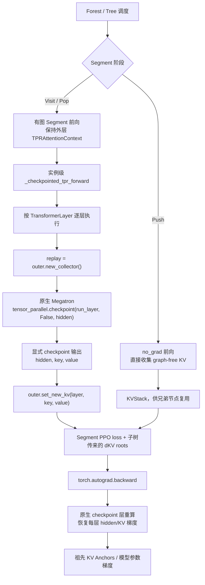

# TPR Recompute 方案

> **项目**：Tree Prefix Reuse（TPR）在 Ascend NPU / Megatron 中的 Activation Recompute 适配  
> **代码基线**：[`verl-tpr/main@93b24dff`](https://github.com/1903943257/verl-tpr/commit/93b24dff45d959a56b609cd99893ea90c1b94212)，2026-10-19  
> **状态**：源码已合入主线，**仅显式启用的实验性 `full/uniform/1`** 路径；默认关闭。历史 NPU 实验通过不代表当前合并版本已经完成在线 GRPO/全拓扑生产验收。

## 1. 问题：TPR 有两种完全不同的“重算”

**第一种：Tree 的 Prefix Pop replay，始终是 TPR 基础算法的一部分。**

- 内部节点 `Push`：`torch.no_grad()` 前向，缓存压实后的逐层 Prefix K/V，不保留计算图。
- 后代 `Visit`：执行本段 loss backward，并将后代对 Prefix K/V 的梯度记录在 KV Anchors。
- 内部节点 `Pop`：释放该节点旧 KV 缓存，**重新有图前向该 Segment**，用本段 loss 与子树传回的 dKV roots 共同反传到祖先参数。

这套 Push/Visit/Pop 不依赖 Megatron `recompute_granularity`，即使关闭 layer checkpoint 也必须运行。

**第二种：TransformerBlock 的 Activation Checkpoint/Recompute，是可选的显存优化。**

- 解决单次**有图** Segment forward 保存 Transformer 层内激活过多的问题；
- backward 时重新执行 Transformer 层，把计算时间换为更低激活显存；
- **不能代替** Tree Pop：层级 checkpoint 只控制一个 Segment 内的激活，不负责兄弟分支的共享 KV、dKV 累积及梯度回传顺序。

因此正确嵌套关系是 **Forest → Tree Push/Visit/Pop → 每个有图 Segment 的 TransformerBlock Checkpoint**；而不是把两套重算合并成一个通用 Python backward hook。

## 2. 为什么不能直接无改动复用原生 checkpoint

TPR SelfAttention 除了正常的 Transformer hidden states，还通过 `TPRAttentionContext.set_new_kv()` 产出**每一层自己的 K/V**。这些 K/V 不只是中间缓存，而是树中其它 Segment 将要引用、并在 Pop 阶段注入外部 `dK/dV` 的**梯度根**。

普通 Megatron `TransformerBlock._checkpointed_forward()` 主要以 hidden output 作为 checkpoint 函数结果；直接在 TPR 路径上照搬会遇到：

1. **显式输出缺失**：checkpoint 的重算图必须把每层**新 K/V** 与 hidden 一起作为可微输出，否则后续 `context.new_key_values[layer]` 并不可靠地连接到 checkpoint 重新构造的层级计算图，子树传回的 dKV 可能无法正确反传到该层参数。
2. **重算 Context 生命周期**：checkpoint 函数在 backward 时再次调用层 forward，必须读取相同祖先 Prefix Anchors、Segment 绝对 RoPE 位置与 CP Attention backend；又必须使用**新建的层级 KV 收集器**，避免重算覆盖外层 Segment 原始 KV。
3. **CP 正反向合同**：重新运行的层仍会触发 Ring P2P/FA，需要同一 TP×CP group、同一 Segment 顺序和匹配的 Shard/Padding；CP Rank 无本地 objective 也不得擅自跳过。
4. **引用生命周期**：闭包若强持有 `TPRAttentionContext`，可能构成 checkpoint autograd ctx → run function → outer context → KV tensor/grad_fn → checkpoint ctx 的跨 Python/C++ 引用环，导致 NPU 存储跨 iteration 不释放。

这不意味着**重写原生 checkpoint kernel**。我们需要修改的是**模型实例的 TransformerBlock checkpoint 包装接口及其 KV side outputs**，底层仍调用 Megatron 自带 `tensor_parallel.checkpoint()`，保留其 TP RNG / backward 行为。

## 3. 方案与模块改动

### 3.1 模型构建期安装，训练前反向期校验

| 文件/接口 | 改动及责任 |
| --- | --- |
| [`transformer_impl.py`](../../verl/workers/engine/megatron/transformer_impl.py) | TPR 模型安装 ModuleSpec 之后，在显式启用 checkpoint 的情况下调用 `install_tpr_full_recompute(unwrap_model(...), updated_tf_config)` |
| [`recompute.py`](../../verl/workers/engine/megatron/tpr/recompute.py) | 校验配置；**只为当前模型实例**安装 `_checkpointed_tpr_forward`；构造每层输出 `(hidden, key, value)` 的 checkpoint |
| [`adapter.py`](../../verl/workers/engine/megatron/tpr/adapter.py) | 进入 PPO F/B 前调用 `assert_tpr_full_recompute_installed()`；防止“只打开配置，KV 梯度实际未适配” |
| [`context.py`](../../verl/models/mcore/tpr/context.py) | `TPRAttentionContext.new_collector()` 每次 replay 新建 KV 收集器，保留共享 Prefix/CP 后端引用 |
| [`executor.py`](../../verl/workers/engine/megatron/tpr/executor.py) | 保持 Segment 外层 Context 活到 backward 完成；Push 原样 no-grad，Pop/Visit 触发有图 checkpoint |
| [`attention.py`](../../verl/models/mcore/tpr/attention.py) | 原生 QKV/RoPE/Projection + Context 的每层 K/V 收集器接口，不另维护一套 recompute attention |

**没有修改 Megatron-LM 或 MindSpeed 全局 checkpoint 源码。** 安装器采用 `MethodType` 给具体 `TransformerBlock` 实例替换 `_checkpointed_forward`，并保留原 bound method 作非 TPR 回退。`install_tpr_full_recompute()` 会先检查所有 Block 的 Dense SelfAttention 和 checkpoint signature，不能在一半模型上安装成功后再静默跳过其它层。

### 3.2 执行关系图



图中 `tensor_parallel.checkpoint()` **只用于需要图的层前向**；Push 在 no-grad 下直接执行各层并收集 KV，不做不必要的 layer checkpoint。反向由原生 checkpoint Function 触发每层 replay，再通过 Explicit K/V 输出把子树 dKV 送回 QKV 参数及更早祖先。

### 3.3 关键实现：每层 KV 是 checkpoint 的真实输出

在 [`_checkpointed_tpr_forward()`](../../verl/workers/engine/megatron/tpr/recompute.py) 内，针对每个真实 `TransformerLayer` 定义 `run_layer(x)`：

```python
replay = current_outer.new_collector()
with use_tpr_attention_context(replay):
    layer_output, layer_context = layer(
        hidden_states=x,
        attention_mask=attention_mask,
        rotary_pos_emb=rotary_pos_emb,
        # 其它字段按受支持 Dense Decoder 约束验证
    )
new_key, new_value = replay.new_key_values[layer.layer_number]
return layer_output, new_key, new_value
```

有梯度时：

```python
hidden, key, value = tensor_parallel.checkpoint(
    run_layer, False, hidden
)
outer.set_new_kv(layer.layer_number, key, value)
```

- `new_collector()` 对外层 Prefix/CP backend 保持同一引用与配置，但每次 forward 重新收集本层新 KV；不会把旧 collector 里的 K/V 与 replay 结果混淆。
- `hidden` 和 `(K,V)` 均为 checkpoint 输出，因此 Segment 的 `torch.autograd.backward(本段 loss, 后代 dKV roots)` 能穿过 Layer checkpoint。
- 非 TPR Context（`outer is None`）直接回退实例保留的原生 `_checkpointed_forward`。
- 要求有图路径的 `hidden.requires_grad=True`；不满足则显式失败，不允许“看似运行成功却丢失 KV 梯度”。

**不能改成仅依赖一次 `outer.set_new_kv()` 的副作用而不返回 `(K,V)`**；这是与原生 checkpoint 不同的核心设计。

## 4. 内存生命周期：为什么引入 weakref

### 4.1 历史问题

checkpoint autograd 保存 `run_layer`。如果它的闭包直接捕获 `outer` 强引用，而 `outer` 又持有与 checkpoint graph 连接的 K/V，可能形成：

```text
CheckpointFunction.ctx
  → run_layer closure
    → outer TPRAttentionContext
      → (K,V) / grad_fn
        → CheckpointFunction.ctx
```

这类跨 Python/C++ 引用环可能无法在每次 Replay 后及时释放，造成训练步间 NPU 显存累积、最终 OOM。历史 40K 八轨迹实验曾观察到每次增量约 **13.5 GiB**、最后 OOM；改成 weakref 后持续迭代不再增长，详见 [原始 Recompute 记录](recompute_prototype.md)。

### 4.2 当前方案

- checkpoint closure 保存 `outer_ref = weakref.ref(outer)`，不强持有整个 Context；
- 执行时先 `current_outer = outer_ref()`，若对象已释放则显式报错；
- **Executor 的 `_backward_segment()` 在有图 Forward、checkpoint replay 和 backward 完成期间仍强持有外层 Context**，所以正常生命周期内 weakref 可以安全解引用；
- Debug `TPR_RECOMPUTE_REF_AUDIT=1` 仅记录 run function 与 Context 的**弱引用数量**，默认关闭；不允许使用强引用调试容器长期持有 KV；
- 原 Segment Pop 释放旧 graph-free Prefix KV 的位置仍由 `state.py` / `executor.py` 管，layer checkpoint 不额外维护共享树 KV 栈。

recompute 降的是层激活图的峰值；**不能消除** DFS 路径上 Prefix KV、Anchor/dKV 缓存和 Ring 通信缓冲。需分别报告 `peak_allocated`、`peak_reserved` 和重复迭代的稳态内存。

## 5. 当前允许的配置和失败门禁

| 配置 | 当前状态 |
| --- | --- |
| `recompute_granularity=full` | **仅受限支持** |
| `recompute_method=uniform` + `recompute_num_layers=1` | **唯一允许组合**，每层一个 checkpoint |
| 未设置 `recompute_granularity` | 关闭 TPR-aware layer recompute，保留原生 Tree Push/Pop |
| `selective`、`block` 非 `uniform/1` 方案 | 显式拒绝 |
| PP / VPP | 仅 PP=VPP=1 |
| MoE / 非 Dense FA / 其它 SelfAttention | 未支持 |
| FP8 / FP4 | 未支持 |
| CPU activation offload、Swap Attention、`distribute_saved_activations=True` | 未支持同时开启 |
| MTP / routing replay | 由上层生产 PPO gate 拒绝 |
| TP×RingCP×DP2 | 已有**实验性离线**对照；DP2 生产 Trainer dispatch 仍未开放 |

启用时由真实 Megatron `override_transformer_config` 指定参数（字段以对应 actor Megatron 配置为准），示例：

```yaml
override_transformer_config:
  recompute_granularity: full
  recompute_method: uniform
  recompute_num_layers: 1
```

必须同时正常启用 TPR 模型 `tpr_enabled=True`。**仅设置这三个参数并不能说明 TPR 已进入 checkpoint 正确路径**：`transformer_impl.py` 需成功安装实例方法，`adapter.py` 在训练前验证安装状态。当前主线不是“所有 Megatron recompute 模式可以直接服用”。

## 6. 已有正确性与性能证据

以下为**历史离线重放**数据，来源与基线保留在 [实验结果](TPR实验结果.md) 和 [recompute_prototype.md](recompute_prototype.md)。不是本次文档提交重新运行 NPU。

### 6.1 TP2×CP4 两 sibling：OFF/ON 完整梯度

2026-10-16 历史 Qwen3-4B 真实 Actor PPO rows (4,6)，TP2×RingCP4，4,616 PPO token：

- TPR OFF vs ON：Loss 和 Response Logprob 相同；
- **完整 BF16 参数梯度** rel-L2 **0.0102476857（1.025%）**，不是完全 bitwise 一致；
- 这是**同一 TPR 算法前提下**隔离 layer recompute 的梯度差异；不能将其当 Full/TPR 整体一致性通过。

### 6.2 TP2×CP2×DP2 / 30K：OFF/ON 受控实验

2026-10-18 Qwen3-4B-128K、8 NPU、真实固定 Actor Step 6、同 capture，**实验性 FP32 逐参数梯度同步**：

| 指标 | Recompute OFF | Recompute ON |
| --- | ---: | ---: |
| F/B+finalize median | **12.362386 s** | **16.534103 s** |
| 峰值 allocated | **40.653 GiB** | **16.403 GiB** |
| global PPO loss 差 | \- | **3.7252903e-9** |
| 完整 BF16 参数梯度 shards rel-L2 | 参考 | **0.00922255517（0.9223%）** |

**显存降低 24.250 GiB（59.65%），耗时增加 33.74%。** 后续 CPU FP32-master 单步 AdamW 进行了抽样更新比对（max abs gap `3.05175781e-5`），但计时不包括该独立 optimizer，也未执行连续生产 GRPO 更新。BF16 默认梯度同步的历史副本误差不能被这个 FP32-controlled PASS 掩盖。

### 6.3 40K：仅 ON 容量验证

相同实验线的 40K Step6 Recompute ON-only：median **28.582731 s**，峰值 allocated **20.419 GiB**。由于没有成功完成的 40K OFF 同条件对照（容量 OOM），**不能**声称 40K 的 OFF→ON 显存百分比或相对加速。

另有 TP2×CP4 40K Step6、Full/TPR OFF/ON 的历史矩阵，但其中 TPR ON 运行过 GC/weakref 诊断；正式吞吐结论需要关闭诊断重新测量。

## 7. 验证顺序与验收标准

尽量复用仓库已有测试，而不是另写一套与当前生产路径不一致的实验：

| 层级 | 已有测试/入口 | 要求 |
| --- | --- | --- |
| CPU 参数与 KV checkpoint 合同 | [`test_tpr_full_recompute_cpu.py`](../../tests/models/mcore/tpr/unit/test_tpr_full_recompute_cpu.py) | Full/Uniform(1) 门禁、K/V side outputs、weakref、Context 与 replay |
| 单 NPU 原生 checkpoint | [`test_tpr_kv_checkpoint_replay_npu.py`](../../tests/models/mcore/tpr/correctness/test_tpr_kv_checkpoint_replay_npu.py) | 显式 K/V 梯度根、TP RNG 与 backward |
| CP4 Actor OFF/ON | [`run_real_actor_tp2cp4_offline_ppo.sh`](../../tests/models/mcore/tpr/parallel/run_real_actor_tp2cp4_offline_ppo.sh) | 同样数据和真实 `old_log_probs`/advantages；logprob、loss、完整梯度 |
| DP2 离线 OFF/ON | [`compare_tpr_dp2_recompute.py`](../../tests/models/mcore/tpr/parallel/compare_tpr_dp2_recompute.py)、[`run_tpr_dp2_recompute_validation.sh`](../../tests/models/mcore/tpr/parallel/run_tpr_dp2_recompute_validation.sh) | 同 TP/CP/DP、FP32/BF16 同步模式明示、梯度副本及更新 |
| 显存/时间 | [recompute_prototype.md](recompute_prototype.md) 原有运行记录 | 1 次 warmup+多次稳态、相同输入、无 profiler/GC 干扰；记录 allocated/reserved |
| 连续 optimizer 训练 | 仍需补充正式统一回放 | 至少多步 AdamW、FP32 master、optimizer state、参数更新及 held-out Full 验证 |

单 NPU 显式 KV checkpoint 测试可从已配置的 NPU 环境运行：

```bash
python -m pytest -q tests/models/mcore/tpr/unit/test_tpr_full_recompute_cpu.py

TPR_RUN_KV_CHECKPOINT_REPLAY=1 \
torchrun --master_addr=127.0.0.1 --master_port=29557 --nproc_per_node=1 \
  -m pytest -q -s tests/models/mcore/tpr/correctness/test_tpr_kv_checkpoint_replay_npu.py
```

**生产验收不能只看**显存下降、同一个 scalar PPO loss 或 grad norm；必须检查真实 Root/Leaf/Pop 的 Prefix dKV、完整参数梯度 rel-L2、TP×CP replicas 和真实 optimizer 更新。对 Recompute ON 的任何优化都不能强制改变 Native Full GEMM 形状或打开历史 Fixed Tile。

## 8. 现有限制与可持续维护方案

- 只在 **TPR 模型实例**安装 `_checkpointed_forward`，不允许对 Megatron/MindSpeed 全局 monkeypatch；原生非 TPR checkpoint 调用保持不变。
- 重算 collector、Prefix Anchor 和 CP backend 生命周期必须有清晰拥有者；**Executor 保留 outer Context 至 backward 完成，run function 只保留弱引用**。
- 保留原生 `tensor_parallel.checkpoint()` 和 TP RNG 行为；可精简包装层，但不能丢掉每层显式 `(K,V)` checkpoint outputs。
- 不支持或未经过 NPU 验收的 config 必须 **fail fast**，不默默回退到仅保存 hidden 的原生 checkpoint。
- 下一阶段优先验证相同捕获、同等并行拓扑的 TPR OFF/ON 对照，再评估 30K/40K、DP2、真实 Actor optimizer 和多步训练的时间/显存/梯度闭环。历史单步数据可直接更新到 [《TPR实验结果》](TPR实验结果.md)。

相关：[TPR开发文档](TPR开发文档.md) · [TPR Ring CP 方案](ring_design.md) · [早期 Recompute 开发与测试记录](recompute_prototype.md)。
