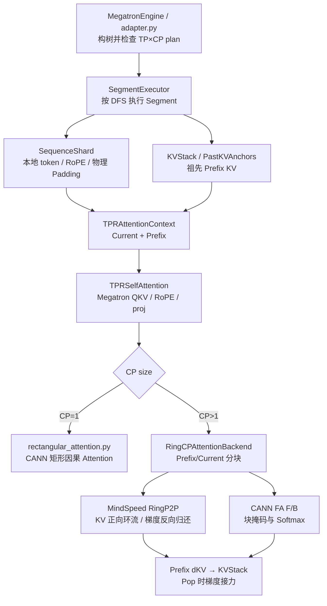

# TPR Ring CP 方案

> **项目**：Tree Prefix Reuse（TPR）在 Ascend NPU 上的 Prefix-aware Ring Context Parallel  
> **代码基线**：[`verl-tpr/main@93b24dff`](https://github.com/1903943257/verl-tpr/commit/93b24dff45d959a56b609cd99893ea90c1b94212)，2026-10-19  
> **定位**：本方案解释当前主线 Ring 的实现、为什么不能直接复用普通 Ring、与 MindSpeed/CANN 的边界，以及验证和优化状态。不是重新提出独立 CP 通信算法。

## 1. 问题、目标与实现原则

普通 Megatron/MindSpeed causal Ring 通常处理**同一完整序列**分片后的 Q/K/V；TPR 训练时，一个待执行的 Segment 仅产生当前 `S` token 的 Q/K/V，却要对沿 Tree 路径已经缓存的多个祖先 Segment（总长 `P`）做 Attention：

- **Current Q**：仅当前 Segment 的查询，逻辑长度 `S`。
- **Prefix KV**：祖先节点的逐层 K/V，逻辑长度 `P`；来源可能是多个具有不同长度和不同 CP Shard 的 Segment。
- **Current KV**：当前节点的 K/V，长度 `S`。
- **逻辑可见性**：Prefix KV 对当前所有真实 Q **完全可见**；Current KV 对 Current Q **因果可见**。不是将各段在物理 Rank 上简单拼接后直接使用原生 whole-sequence causal Ring。

目标是在 **CP=2/4 + TP=1/2** 的受支持组合上复用 Megatron/MindSpeed 的通信与投影，实现 **Prefix-aware 矩形因果 Attention + 可微的跨 Rank dKV 回传**。

遵循三个边界：
1. 复用原生 Megatron CP group、Megatron TP 投影、MindSpeed `RingP2P`、Ascend `npu_fusion_attention`/`npu_fusion_attention_grad`；**不自建通信进程组或新 NPU 算子**。
2. Tree、Prefix KV 生命周期和 PPO 目标归 Engine 管；`ring.py` 只管一个 Segment/一层的 CP layout、可见块、Attention 与 backward。
3. **一个代码所有者**：`verl/workers/engine/megatron/tpr/ring.py` 同时维护 Ring layout、`SequenceShard`、Padding、块有效性和反向；不另外复制一套模型侧 CP 实现。

## 2. 模块依赖与执行入口

| 文件 | Ring 相关职责 |
| --- | --- |
| [`executor.py`](../../verl/workers/engine/megatron/tpr/executor.py) | 每个 Segment 创建 CP shard、本地 token/position/RoPE；由 `KVStack` 和当前 shard 构造 Ring backend |
| [`state.py`](../../verl/workers/engine/megatron/tpr/state.py) | 各祖先 Segment 的逐层 K/V、Shard、独立 autograd anchor、dKV 累加和释放 |
| [`ring.py`](../../verl/workers/engine/megatron/tpr/ring.py) | Zigzag/Pad、`RingCPBackend`、Prefix 块调度、CANN FA、在线 Softmax、反向 Ring |
| [`context.py`](../../verl/models/mcore/tpr/context.py) | 把当前 Prefix 长度、当前本地长度、Ring Attention 后端和 KV 收集器注入各层 |
| [`attention.py`](../../verl/models/mcore/tpr/attention.py) | 复用 Megatron QKV、GQA、RoPE、输出投影；CP>1 时调用 `context.attention_backend.attention(...)` |
| [`tree.py`](../../verl/workers/engine/megatron/tpr/tree.py) | TP/CP peers 的 Forest digest 一致性检查；防止跨 Rank 的 Segment 执行计划错位 |
| [`adapter.py`](../../verl/workers/engine/megatron/tpr/adapter.py) | 解析 CP runtime、验证生产 Ring 门禁、调度 Forest、调用原生梯度 finalize |



CP1 不启动 Ring 通信，`SequenceShard.full()` 返回完整逻辑段；CP>1 仅支持 Ring 后端，`resolve_engine_cp_runtime()` 拒绝动态 CP 和未初始化的原生 CP group。

## 3. Shard、Padding 与逻辑/物理位置

### 3.1 设计理由

每个 Segment 的长度不必天然整除 `2×CP`；MindSpeed 对称 zigzag causal Ring 需要各 CP Rank 等长且具有**头/尾两个区间**。TPR 对**每个 Segment 独立**完成对齐：

```text
logical_length = Segment.length
padded_length  = ceil(logical_length / (2*CP)) * (2*CP)
chunk_length   = padded_length / (2*CP)

CP rank r:
  physical range 1 = [r*chunk_length, (r+1)*chunk_length)
  physical range 2 = [(2*CP-r-1)*chunk_length, (2*CP-r)*chunk_length)
```

例如 `S=513, CP=4`：物理补至 **520**，分为 8 个各 65 token 的 chunk，每 Rank 130 个**物理** token：
- Rank0：`[0,65)` 和 `[455,520)`，其中 `[513,520)` 是 **7 个 Padding**；
- Rank1：`[65,130)`、`[390,455)`；
- Rank2：`[130,195)`、`[325,390)`；
- Rank3：`[195,260)`、`[260,325)`。

`SequenceShard.global_ranges` 只包含真实 token；`physical_global_ranges` 包括 Pad，`valid_local_length` 不等于 `local_length` 时必须区分有效位置。

这里的“逻辑地址/物理地址”是 **token 的全局序列下标与 Rank-local 张量下标**，不是 NPU 虚拟内存地址。

### 3.2 统一 API 与消费者

| `ring.py` 接口 | 作用 / 直接消费者 |
| --- | --- |
| `round_up_sequence_length()` | 只计算对齐长度，简单可复用 |
| `make_ring_sequence_shard()` | 依照现有 zigzag 布局构造每 Rank 的两段物理范围 |
| `SequenceShard.select()` | Executor 选本地 token；Pad 要留可微的连接 |
| `global_indices()`、`global_to_local()`、`local_to_global()` | Executor RoPE、Objective PPO query 归属、Prefix KV 梯度映射 |
| `_iter_range_slices()`、`iter_valid_sequence_slices()` | 本地物理段与有效逻辑段的切片对应关系 |
| `_physical_block_attention_mask()` | 遮挡虚拟 KV 和不合法的 Current 未来 token |

**Padding 可以复用 PyTorch 基础算子，Shard 位置映射不能删。** 即使每段刚好整除 `2×CP`、无需 Pad，跨 Rank RoPE、PPO query owner、dKV 返回路径仍依赖 Shard 的全局/本地映射。当前没有单独的 Padding 文件，也不应再维护第二套 Shard 类。

## 4. Prefix-aware Attention 的块语义

对每个 Current Query block 和远端 KV block，`classify_ring_block()` 按**逻辑 Segment 局部坐标**分类：

| KV 类型 / 位置 | 分类 | 处理 |
| --- | --- | --- |
| 任意**祖先 Prefix** block | `FULL` | 当前所有合法 Q 均可见该 Prefix |
| Current KV 全在当前 Query 之前 | `FULL` | 不需要因果 mask |
| Current KV 与 Query 为同一对齐 range | `CAUSAL` | 使用 CANN 右下因果 `sparse_mode=3` 快路径（无 Pad 时） |
| Current KV 全在 Query 之后 | `SKIP` | 不调用 Attention |
| Current KV 与 Query 发生非对齐的部分重叠 | 拒绝 | 不能悄悄将非对齐块当作可运行 causal |

如果存在 Pad，使用物理 bool mask/validity 向量，保证**虚拟 Key 不参与 Softmax，虚拟 Query 不参与有效 loss/梯度**。`SKIP` 不进入 FA。不能仅在 PPO loss 处屏蔽 Pad：Padding Key 如果错误参与 Softmax，真实 Query 的输出已经被污染。

### 4.1 Forward：Ring 环流 + 在线 Softmax

1. `RingCPBackend.make_attention_backend()` 为当前层建立按祖先顺序排列的 `RingLocalKVBlock`，以及 Current KV；每块各有自己的 Shard。
2. `_circulate_kv()` 用 MindSpeed `RingP2P` 的两个可复用缓冲区环流 K/V，边通信边消费；**不缓存所有远端 KV 副本**。
3. 对每个 source rank 的 Prefix 与 Current KV，`_source_schedule()` 生成 `FULL/CAUSAL/SKIP` 物理块；CANN TND FA 处理真正需要计算的块。
4. `_merge_attention()` 使用每块 Attention 的 `softmax_max/softmax_sum` 做 **FP32 online-softmax** 合并；避免逐块 BF16 回铸引入额外误差，最后对最终结果一次 cast。
5. 产出当前 Rank 的局部输出供 Megatron `linear_proj`；Padding Query 输出清零，Softmax 状态供 backward 使用。

这不是把整段 Prefix KV `all_gather` 到每一张卡，也不是简单对 Prefix/Current 两个结果做均值。需要按 log-sum-exp 归一化合并各 source/block 的贡献。

### 4.2 Backward：dQ 汇总 + dKV 归还

`_RingTPRAttention.backward()` **显式使用与 Forward 一致的块 mask / visibility** 调用 `torch_npu.npu_fusion_attention_grad`：

- 本 Rank 对所有 Prefix/Current 来源的 `dQ` 在 FP32 临时累计，最后归还当前 Q；
- 每个来源的 `dK/dV` 累计到该 KV 来源的梯度缓冲，屏蔽虚拟 Padding；
- `_reduce_ring_gradients_to_owner()` 使用 MindSpeed 反向 Ring `RingP2P`（固定 ping-pong 缓冲区），使远端 dKV 回到**KV 的原始拥有 Rank**；
- Ring 输出梯度再流入 `PastKVAnchors`，由 `state.py` 累加到正确祖先 Segment；最终 `executor.pop()` 通过 Segment 有图重算把 dKV 传回模型参数。

**Ring 的 dKV 回送 ≠ Tree 的 Prefix 梯度接力**：前者解决 CP Rank 间“谁拥有 K/V”，后者解决树形时间顺序上的“梯度怎样回到祖先参数”。两者都不可省略。

CP Rank 本地没有任何有效 PPO Ref 时也不能单独跳过 backward；否则其他 Rank 的 Ring collective 对不上。Executor 对无本地监督的情况保留连通的 zero loss root，使同一模型并行组依然进入兼容的反向调度。

## 5. 为什么不能直接用 MindSpeed 的普通 Ring

| 能力 | 原生 MindSpeed Ring | TPR 扩展部分 |
| --- | --- | --- |
| CP group、RingP2P 传输、原生通信 | 已有，**复用** | 不重复实现 |
| 普通完整序列 causal Attention | 已有 | 当前 Segment Q 对多个外部 Prefix Segment KV 的块 schedule 不同 |
| Prefix KV 的多段独立 Shard / Padding | 原生 whole-sequence 不负责 | `SequenceShard`、`RingLocalKVBlock`、有效区间 |
| Prefix 对所有 Current Q 全可见 | 与普通单序列因果切分不同 | `FULL/CAUSAL/SKIP` 逻辑 |
| Backward 的远端 dKV 与祖先 Segment 对齐 | 原生不维护 Tree 生命周期 | Ring dKV 归还 + KVStack/Anchor 接力 |
| 无 Prefix 的真正 Root | 原生可能可用 | 实验性 `TPR_ROOT_NATIVE_RING=1` opt-in，非默认 |

原生 Ring 作为 Root 快路径必须仅在**实际 Tree Root**、没有祖先 Prefix 的条件下进入，不能因为某层或某个局部 Rank 没看到 Prefix 就直接切换后端。

## 6. 性能优化状态与开关

主线 `ring.py` 仍保留优化实验，不代表生产默认已启用：

| 选项 | 默认 | 作用 / 验收要求 |
| --- | --- | --- |
| `TPR_RING_COALESCE_PREFIX_FULL` | `0` | 合并同源 Prefix 的多个 KV FULL 块；需检查实际 FA 调用与 backward parity |
| `TPR_RING_COALESCE_PREFIX_QUERY` | `0` | 在满足条件时用**整个物理 local Query** 对 Prefix 做一次 FULL FA；需 mask 虚拟 Query 并保护 dQ/dKV |
| `TPR_RING_COALESCE_PREFIX_PADDED` | `0` | 在安全条件下允许物理 Padding 的 Prefix 使用有效段 zero-copy KV 合并；真实 Key 不含 Pad |
| `TPR_ROOT_NATIVE_RING` | `0` | 仅实际 Root 使用 MindSpeed Native Ring |
| `TPR_ROOT_NATIVE_RING_PHASE` | `both`（仅开启 Root 选项后生效） | 可选 `push`、`pop`、`both`，用于定位差异 |
| `TPR_RING_BLOCK_STATS` | `0` | 输出首层每 Segment 的 F/B FA 调用、节省调用等计数；**非性能计时器** |

**正确的优化顺序**：固定真实 Actor Capture，先 OFF/ON 数值与梯度；然后比 FA 调用数；最后关闭日志与 profiler 测量 rank-max 时间、峰值显存。`fa_prefix_calls_saved > 0` 不能独立证明实际训练吞吐增加；也不能将未验证的 qkvmerge/Root Ring 视为现在已经生效的默认加速。

## 7. 验收、数值限制与风险

### 7.1 推荐复用已有测试，而不是新建一套框架

- [`test_sequence_shard_cpu.py`](../../tests/models/mcore/tpr/unit/test_sequence_shard_cpu.py)：CP 物理/逻辑位置、Padding、Shard 选择和梯度。
- [`test_ring_cp_attention_contract.py`](../../tests/models/mcore/tpr/parallel/test_ring_cp_attention_contract.py)：CP Ring 形状、Mask、FULL/CAUSAL/SKIP 约束。
- [`test_ring_numerics_cpu.py`](../../tests/models/mcore/tpr/parallel/test_ring_numerics_cpu.py)：Softmax/累积的数值参考与相关合同。
- [`test_ring_cp_attention_npu.py`](../../tests/models/mcore/tpr/parallel/test_ring_cp_attention_npu.py)：Ascend CP Ring 正反向、梯度归还。
- [`test_ring_coalescing_schedule.py`](../../tests/models/mcore/tpr/unit/test_ring_coalescing_schedule.py)：合并调度。
- [`test_tpr_tp2cp2dp2_one_step_npu.py`](../../tests/models/mcore/tpr/parallel/test_tpr_tp2cp2dp2_one_step_npu.py)：离线 Actor/DP 并行组合验证入口。
- [TPR 实验结果](TPR实验结果.md)：历史 Full/TPR 性能和 BF16 梯度对照，不把稀疏梯度门禁失败写成成功。

### 7.2 必须单独记录的正确性门禁

1. **结构**：不同 CP Rank 对同一个 Forest 的 segment IDs、token/ref 元数据和执行顺序相同；通过 Forward 前 `assert_tp_plan_agreement()`。
2. **Attention 数值**：CP1 方形 Full 与矩形、CP2/CP4 Prefix Ring；分别测 unpadded/padded、多段 Prefix、GQA、CAUSAL/SKIP。
3. **反向**：dQ、Current dK/dV、Prefix dK/dV 非零且与参考对应；不同来源回到原 Rank，`KVStack` Pop 后为空。
4. **真实 PPO**：同 Token/旧 Logprob/Advantage/Temperature，保留 `t-1` 监督查询和无 local Ref 的 Rank collective；检查 PPO clip 分支、完整参数梯度而不只看 loss。
5. **性能**：只把同样模型/数据/拓扑的 Full-vs-TPR 比例解释为算法收益；DP2 与 CP4→CP2 同时变化时必须单独报告。

已知 BF16 Full 与分段执行可能有 GEMM 形状与梯度累加顺序差异。**不要启用历史 Fixed Tile 来人为改变 Full**；应分别隔离分段、真正 KV 共享、Ring 和 PPO clipping 的影响。

## 8. 维护边界与后续简化建议

- **保留**一个 `SequenceShard` 与一套 block mask；通用 Padding 函数可以复用，但不得失去逻辑与物理 token 对应。
- **保留** Prefix-aware Ring 的 F/B 和 dKV 所有权；避免从 `executor.py`、`state.py` 再复制通信代码。
- **优先缩小** `ring.py`（当前主线千余行）中独立的静态布局、CANN 调用与反向运输的函数责任范围；如未来拆分文件，先把 F/B 共享 mask/layout 抽成单一数据契约，再做回归，不能为了文件行数直接复制或改数值算法。
- **生产默认**继续使用当前已经验收的 Prefix-aware Ring 基础路径；任何 Root 快路、Prefix Q/KV merge 都以独立 NPU 梯度门禁与真实耗时结果为准。

相关：[TPR开发文档](TPR开发文档.md) · [TPR Recompute 方案](recompute_design.md) · [主线 Ring 归因/扩展说明](architecture.md)。
