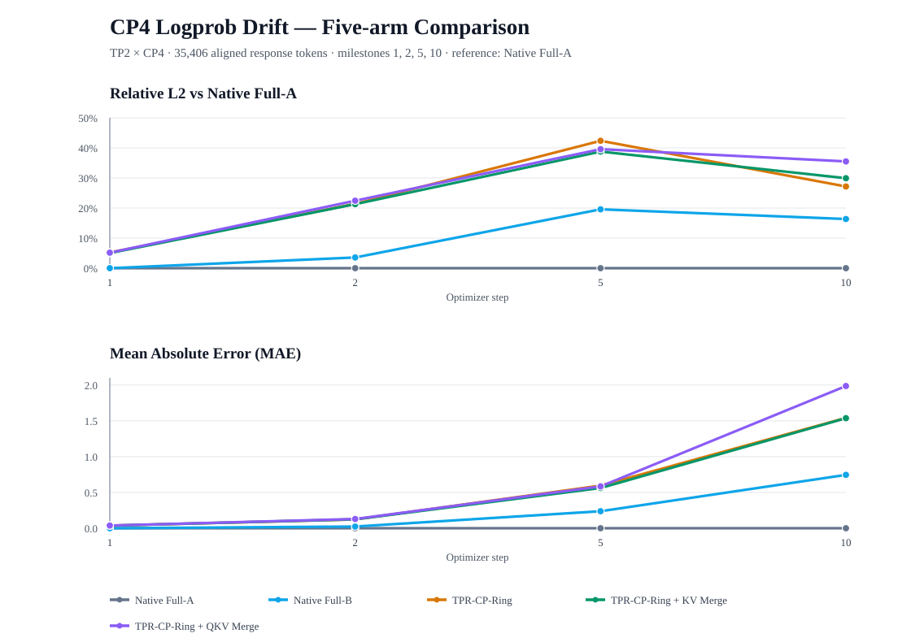

# CP4 Ring / QKV Merge Numerical Correctness Closeout

**Date:** 2026-11-03  
**Status:** Accepted as the Phase-1 CP4 numerical reference; no further first-phase rerun is required.

## 1. Scope and protocol

This experiment records a five-arm, 10-step fixed-capture numerical replay for the CP4 Ring path.

| Item | Value |
|---|---|
| Parallel topology | TP2 × CP4, 8 NPU ranks |
| Model | Qwen3-4B-128K (launcher default; see the run's experiment.txt for the resolved path) |
| Capture | Pre-generated, non-aligned synthetic Actor-PPO capture; 8 rows |
| Capture protocol | synthetic_cp4_ring_padding_actor_capture_v1 |
| Replay | 10 fixed PPO optimizer updates; milestones 1, 2, 5, 10 |
| Optimizer | CPU FP32-master AdamW, lr=2e-5, clip norm=1.0 |
| Recompute | OFF |
| Tree policy | Token-LCP; minimum segment length 128 |
| Padding | Physical CP prefix padding is audited on the TPR arms |
| Full-gradient dump | OFF (TPR_OFFLINE_SAVE_FULL_GRADS=0) |

This is a fixed-data training-side numerical replay, **not an on-policy RL convergence test or online E2E experiment**. The launcher records the resolved capture path, SHA-256, model path, and device list in the run's experiment.txt.

## 2. Five arms and naming

| Report name | Historical output folder | Runtime path | Merge configuration |
|---|---|---|---|
| **Native Full-A** | full_a | Native Megatron/MindSpeed CP Ring schedule | No TPR |
| **TPR-CP-Ring** | none | TPR SegmentExecutor + custom CP Ring | KV merge OFF; Query merge OFF |
| **TPR-CP-Ring + KV Merge** | kv | TPR SegmentExecutor + custom CP Ring | KV merge ON; Query merge OFF |
| **TPR-CP-Ring + QKV Merge** | qkv | TPR SegmentExecutor + custom CP Ring | KV merge ON; Query merge ON |
| **Native Full-B** | full_b | Native Megatron/MindSpeed CP Ring schedule | No TPR |

**Important naming clarification:** the historical arm called none is **not** TPR-disabled. It runs mode=tpr through the TPR SegmentExecutor; only the Ring KV/Query coalescing switches are disabled. Its correct name is **TPR-CP-Ring**. The historical folders are left untouched; the maintained launcher now uses explicit names for future runs.

The TPR arms all exercise physical prefix padding. The KV and QKV arms additionally request the padded-KV merge path; QKV also requests Query merge. The launcher's MERGE_AUDIT checks that physical padding is observed and that the requested KV/Query merge calls actually execute.

Native Full-A/B use the native Megatron/MindSpeed CP Ring attention and schedule, not the TPR SegmentExecutor. They are the native baseline repeatability control within this offline harness; this should not be conflated with a full production VERL Trainer E2E replay.

## 3. Logprob comparison

The comparison covers **35,406 aligned response-token Logprobs** at each saved milestone. The analysis combines the four CP shards for TP rank 0, so each logical response token is counted once.

All TPR and Full-B curves below are measured against Native Full-A at the same milestone. Native Full-A is the zero reference by definition.



### Metric definitions

- **Relative L2:** ||x - y||₂ / ||x||₂, with Native Full-A as x for the plotted comparisons.
- **MAE:** mean absolute error, mean(|x - y|), in log-probability units (nats); it is not a percentage.
- **Max Abs:** maximum single-token absolute Logprob difference.

### Full pairwise results

| Step | Comparison | Rel-L2 | MAE | Max Abs |
|---:|---|---:|---:|---:|
| 1 | Native Full-A vs Native Full-B | 0.0000% | 0 | 0 |
| 1 | Native Full-A vs TPR-CP-Ring | 5.2082% | 0.0370232 | 4.746 |
| 1 | Native Full-A vs TPR-CP-Ring+KV Merge | 5.0302% | 0.0363992 | 2.99729 |
| 1 | Native Full-A vs TPR-CP-Ring+QKV Merge | 5.1584% | 0.0373683 | 2.92519 |
| 1 | TPR-CP-Ring vs TPR-CP-Ring+KV Merge | 4.5960% | 0.0315048 | 2.24598 |
| 1 | TPR-CP-Ring+KV Merge vs TPR-CP-Ring+QKV Merge | 3.4434% | 0.0190543 | 2.99869 |
| 2 | Native Full-A vs Native Full-B | 3.5598% | 0.0237503 | 1.75007 |
| 2 | Native Full-A vs TPR-CP-Ring | 21.3975% | 0.123119 | 16.9995 |
| 2 | Native Full-A vs TPR-CP-Ring+KV Merge | 21.2940% | 0.124429 | 22.7309 |
| 2 | Native Full-A vs TPR-CP-Ring+QKV Merge | 22.4417% | 0.128983 | 22.2309 |
| 2 | TPR-CP-Ring vs TPR-CP-Ring+KV Merge | 22.5747% | 0.115066 | 22.7088 |
| 2 | TPR-CP-Ring+KV Merge vs TPR-CP-Ring+QKV Merge | 12.2525% | 0.0655488 | 19.7491 |
| 5 | Native Full-A vs Native Full-B | 19.5744% | 0.23749 | 24.4212 |
| 5 | Native Full-A vs TPR-CP-Ring | 42.3646% | 0.595438 | 33.1077 |
| 5 | Native Full-A vs TPR-CP-Ring+KV Merge | 38.7728% | 0.561936 | 38.435 |
| 5 | Native Full-A vs TPR-CP-Ring+QKV Merge | 39.5738% | 0.584378 | 36.56 |
| 5 | TPR-CP-Ring vs TPR-CP-Ring+KV Merge | 38.0857% | 0.577366 | 38.1803 |
| 5 | TPR-CP-Ring+KV Merge vs TPR-CP-Ring+QKV Merge | 23.2190% | 0.368227 | 28.255 |
| 10 | Native Full-A vs Native Full-B | 16.3479% | 0.745285 | 33.4381 |
| 10 | Native Full-A vs TPR-CP-Ring | 27.1645% | 1.54099 | 33.4381 |
| 10 | Native Full-A vs TPR-CP-Ring+KV Merge | 29.9173% | 1.53722 | 41.3601 |
| 10 | Native Full-A vs TPR-CP-Ring+QKV Merge | 35.5028% | 1.98635 | 48.004 |
| 10 | TPR-CP-Ring vs TPR-CP-Ring+KV Merge | 22.8578% | 1.273 | 47.6688 |
| 10 | TPR-CP-Ring+KV Merge vs TPR-CP-Ring+QKV Merge | 20.2405% | 1.2162 | 35.5354 |

Machine-readable source data: [cp4_ring_qkv_logprob_20261103.tsv](cp4_ring_qkv_logprob_20261103.tsv).

## 4. Findings

### Step 1: same initial weights; cleanest forward comparison

- Native Full-A vs Native Full-B is exactly identical for the captured Logprobs: Rel-L2 = 0, MAE = 0, Max Abs = 0.
- Native Full-A vs the three TPR arms is around 5.03%–5.21% Rel-L2, with MAE around 0.0364–0.0374.
- TPR-CP-Ring vs TPR-CP-Ring + KV Merge is 4.596% Rel-L2.
- TPR-CP-Ring + KV Merge vs TPR-CP-Ring + QKV Merge is 3.443% Rel-L2.

Thus the CP4 TPR execution paths have measurable token-level forward differences from Native Full at the same initial weights. KV and Query coalescing also change the token-level Logprobs relative to their neighboring TPR path. The aggregate PPO Loss alone would not reveal these differences.

### Steps 2, 5 and 10: independent training trajectories

Native Full-A and Native Full-B themselves diverge after the first update: their Logprob Rel-L2 is 3.56% at step 2, 19.57% at step 5, and 16.35% at step 10.

The TPR-vs-Full differences at later milestones therefore combine execution-path differences with parameter/optimizer trajectory divergence. They must not be interpreted as a pure per-kernel error measurement. Step 1 is the cleanest same-weight forward comparison.

### Gradient evidence boundary

The run did not save complete parameter gradients (TPR_OFFLINE_SAVE_FULL_GRADS=0). The experiment includes the saved sampled gradient witnesses and sampled/master-update comparisons from the existing comparator, but this report does **not** claim complete-gradient parity. Logprob metrics are forward-output evidence, not a substitute for gradient-vector parity.

## 5. Phase-1 acceptance decision

For the current Phase-1 Dense TPR + CP4 Ring configuration, the measured CP4 numerical drift is recorded as an **accepted reference boundary**. This is an engineering acceptance decision for the tested configuration, not a claim of bitwise equivalence or zero numerical error.

- Keep this five-arm experiment as the CP-related numerical regression reference.
- Do not treat the observed CP4 Logprob drift as an open Phase-1 Recipe release blocker.
- Do not infer that KV/QKV Merge is bitwise equivalent to the base TPR-CP-Ring path.
- Reopen the numerical investigation if the CP layout, Ring attention implementation, KV/Query merge kernels, precision policy, or required parity threshold changes.
- This closeout does not replace independent correctness gates for other topologies, recompute configurations, or model families.

## 6. Reproduction and artifacts

Run from the repository root:

```bash
bash tests/models/mcore/tpr/parallel/run_cp4_qkv_padding_10step_5way.sh
```

Default output directory:

```text
/workspace/tpr_experiments/performance/cp4_qkv_padding_10step_5way_20261103
```

The existing run's raw arm folders retain the historical names (full_a, none, kv, qkv, full_b). The none folder maps to **TPR-CP-Ring** as explained above. Large rank snapshots and run logs remain in the experiment output directory and are intentionally not copied into Git; this repository stores the launcher, compact metrics, graph, and interpretation.
